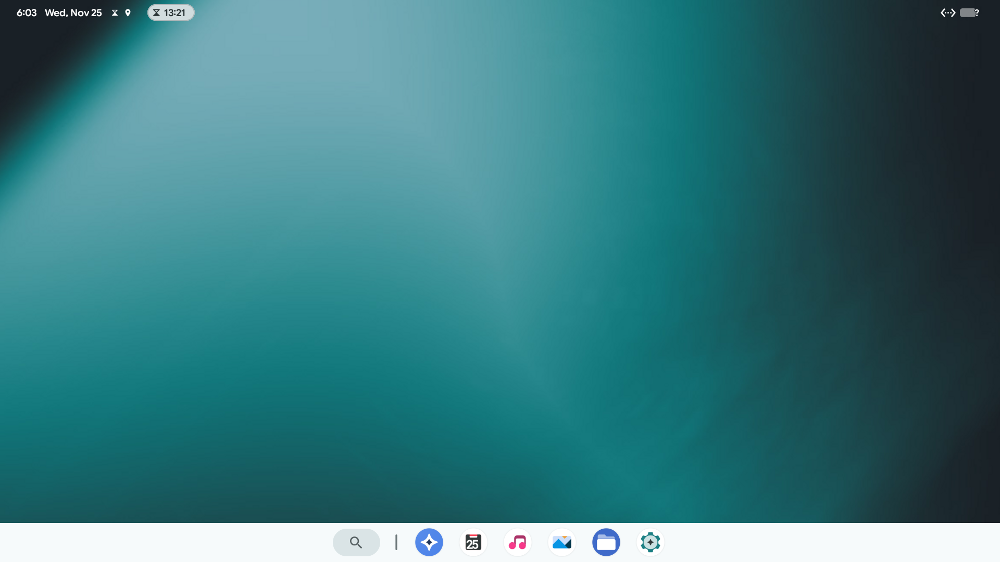
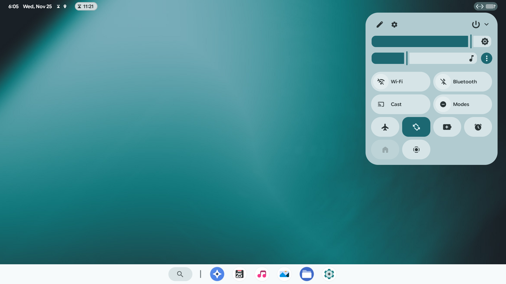
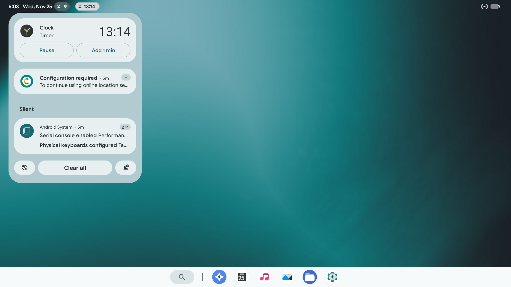
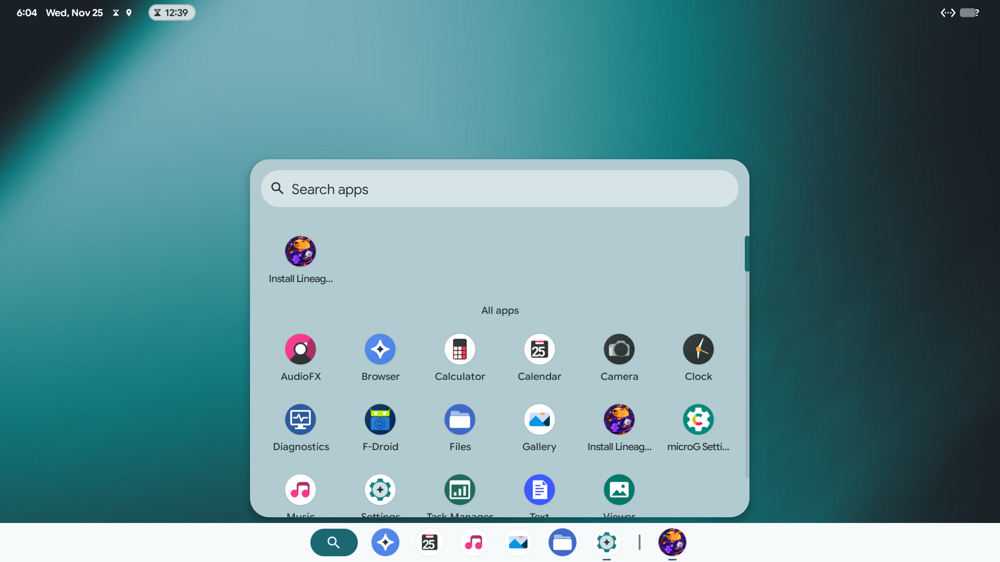
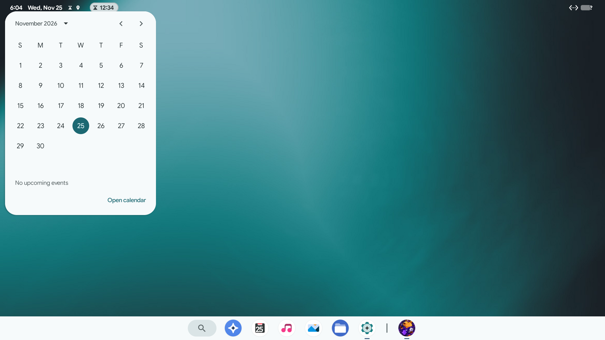
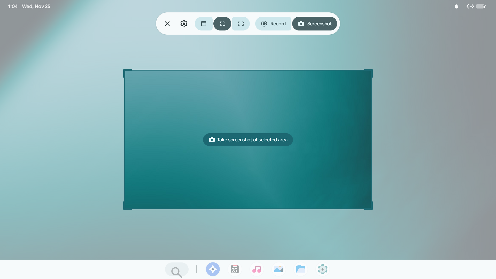
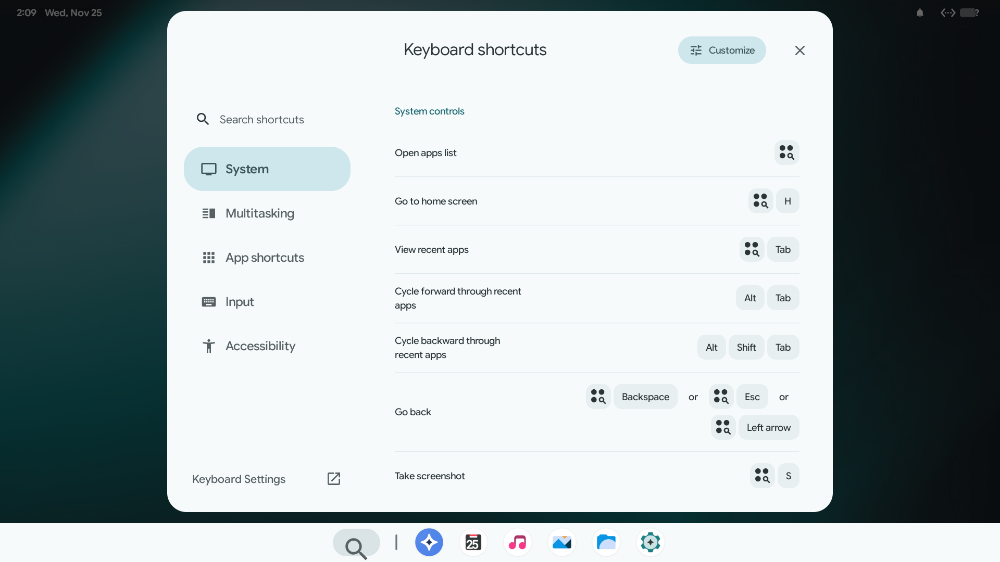

# vendor/pc/ui

Desktop UI of LineageOS for PCs: Googlebook-like desktop windowing, taskbar, status bar, quick
settings, notifications and window headers, on top of LineageOS 24.0 (Android 17).

This repository holds the product level pieces. Code changes live on branch `pc` of
`frameworks/base` (WM Shell) and `packages/apps/Launcher3`; Googlebook's desktop behaviors that no
flag of this tree can turn on are written anew on branch `flags2` of both, each behind its own config
that the overlays here switch on. `DESIGN.md` maps every Googlebook
element to what implements it and what is still missing.

## Layout

| Path | What |
|---|---|
| `pc_ui.mk` | Product makefile the device inherits: installs the overlays, adds the flag values, inherits `packages/apps/PcClocks/pc_clocks.mk` (lock screen clocks) when present |
| `pc_login.mk` | Optional, inherited first: the PC starts on a login screen (headless system user mode, `PcLogin`) |
| `overlay/PcLoginFrameworkOverlay` | `android`: users and the login screen (sign out through the login screen, guests, lock screen defaults, activities allowed over the login screen) |
| `sysconfig/` | Which users get which system packages under `pc_login.mk` (the setup wizard stays off user 0) |
| `overlay/PcDesktopFrameworkOverlay` | `android`: desktop windowing on the internal display, 40dp headers, 36dp status bar, radii, icon mask, shade panel colors, letterbox, laptop power keys |
| `overlay/PcDesktopSystemUIOverlay` | `com.android.systemui`: desktop status bar (notifications next to the clock), notifications popup at the top start and quick settings at the top end, window header button sizes (WM Shell resources live in SystemUI), screen capture (toolbar, recordings folder), clock plugin allowlist |
| `overlay/PcDesktopLauncherOverlay` | `com.android.launcher3`: desktop form factor, blur, popups |
| `overlay/*/res/values/config_desktop_behaviors.xml` | Switch on the desktop behaviors of the `flags2` branches (one config each, listed in `DESIGN.md`) |
| `overlay/PcDesktopSettingsProviderOverlay` | `com.android.providers.settings`: desktop defaults |
| `flags/` | aconfig values Googlebook ships enabled, contributed to the `cp2a` release config |
| `permissions/` | Default runtime permissions (SystemUI reads the calendar for the status bar calendar) |
| `tests/` | Host tests (Python) |

## Use

In the device's product makefile:

```make
$(call inherit-product, vendor/pc/ui/pc_ui.mk)
```

and build with the `pc` branches of `frameworks/base` and `packages/apps/Launcher3`, which hold the
screen capture (`capture`), login (`login`) and desktop behavior (`flags2`) work, plus
`packages/apps/PcClocks` and `packages/apps/PcLogin` (see `DESIGN.md`, "Integration"). The
overlays here set configs that only those branches declare.

## Login screen

```make
$(call inherit-product, vendor/pc/ui/pc_login.mk)   # first line of the device's product makefile
```

with `packages/apps/PcLogin` in the tree. User 0 becomes the login screen; the first boot creates the
first user and runs the setup wizard in it. `DESIGN.md`, "Login screen", has the details.

## Flag values

`pc_ui.mk` adds `flags/release_config_map.textproto` to `PRODUCT_RELEASE_CONFIG_MAPS`. Its
`release_configs/cp2a.textproto` contributes `aconfig_value_set-pc-ui-cp2a` to the `cp2a` release
config defined by `vendor/lineage/release`; the release config tool appends it after AOSP's and
LineageOS's value sets, so these values win. The folder is not one of the `vendor/*/*/release`
folders the build discovers on its own, so other products in the tree are not affected.

Check the result without building:

```sh
out/release-config -map build/release/release_config_map.textproto \
    -map vendor/lineage/release/release_config_map.textproto \
    -map vendor/pc/ui/flags/release_config_map.textproto \
    -product lineage_pc_x86_64 -release cp2a -variant userdebug -out_dir /tmp/rc -json -quiet
grep -o 'aconfig_value_set-pc-ui-cp2a' /tmp/rc/*.varmk
```

`flags/aconfig/cp2a/com.android.systemui/scene_container_flag_values.textproto` is kept apart:
it switches SystemUI to the scene container, which the desktop status bar and the shade popups
need, and is the first file to drop if LineageOS's SystemUI changes do not work with it.

## Tests

```sh
cd vendor/pc/ui/tests && python3 -m unittest
```

They check that every overlaid resource exists in its target package (also when it is declared
only on the project's `pc` or `flags2` branch, before that branch is checked out), that every config
the `flags2` branches add is switched on by an overlay, that no Googlebook flag is left unclassified
or undone, that every flag value
names a flag declared in the tree, that the release config wiring is in place, and that the
overlays carry Googlebook's values. `ANDROID_BUILD_TOP` points at the tree (default: three
folders up).

## Screenshots

Taken in QEMU/KVM at 1920x1080 from the live ISO.



Desktop with the taskbar.



Quick settings as a panel under the status area.



Notifications next to the clock: the app icons in the status bar open the panel, and ongoing activities like a timer sit in the same area.



App menu opened from the taskbar.



Calendar opened from the clock.



Screen capture, region mode.



Keyboard shortcuts.

## License

Apache License 2.0, see [LICENSE](LICENSE). Copyright 2026 Mateus Seiboth. Third-party code keeps its own
license (see Credits).

## Credits

- [LineageOS](https://lineageos.org) ([GitHub](https://github.com/LineageOS)): the base system and build this is part of.
- [Android Open Source Project](https://source.android.com): the platform, its APIs and build system.
- The overlays and flag values configure AOSP's own desktop windowing, SystemUI and Launcher3 code.
- [BlissOS](https://blissos.org) ([GitHub](https://github.com/BlissOS)) and the [Android-Generic Project](https://github.com/android-generic): the approach to running Android on PCs that this project follows.

Thanks to everyone behind these projects. Files taken from them keep their original licenses and copyright notices.
